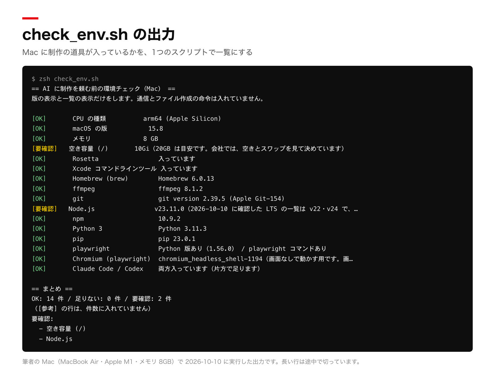

# AI に制作を頼む前の、Mac の整え方

Claude Code か Codex に動画・LP・文章の制作を頼む前に、Mac に必要な道具が入っているかを一覧にする環境チェック（`check_env.sh`）と、足りない物を AI に入れてもらう手順のガイドです。
無料です。株式会社CHIERO　無料ガイド　v2（2026-10-10）

## 何ができるか

- `check_env.sh` を1回実行すると、Mac の状態と道具の有無が一覧になります。主に見る物は、CPU の種類、macOS の版、メモリ、空き容量、Homebrew、ffmpeg、git、Node.js、Python、playwright と Chromium、Claude Code / Codex です。
- 各行に `[OK]`・`[足りない]`・`[要確認]`・`[参考]` が付き、最後に件数のまとめが出ます。
- このスクリプトがするのは、版の表示と一覧の表示だけです。ファイルを作る命令と、通信をする命令は入れていません。
- 足りない物は、ガイドの依頼文を AI に貼って入れてもらいます。パスワードの入力と、設定ファイルの変更の許可は、自分で行います。

対象は Apple Silicon（M1 以降）の Mac です。

## 30秒で試す

```sh
git clone https://github.com/kounkt/ai-setup-guide
cd ai-setup-guide
zsh check_env.sh
```

出力をそのまま Claude Code か Codex に貼って、「足りない物を入れて。パスワードは私が入力する」と頼むと、続きの作業に進めます。
依頼文の全文は、下の「③ 道具の入れ方」にあります。

## 実例

筆者の Mac で実行した出力です（実物の出力を、表示を整えて撮影）。



## 道具がそろった後に使える物

- preflight-reviewer（無料・MIT）：AI が作った物を、作ったセッションとは別のセッションで、出す前に点検するスキルです。
  https://github.com/kounkt/preflight-reviewer
- AI社員一式（note・有料）：18の担当に仕事を分けた会社の運用一式です。役割のファイル、手順36本、全社の決まり6本、朝の報告の型が入った104ファイルで、一式の置き場の確認が付いた、同じ系統の環境チェックも入っています。
  https://note.com/kounkt/n/nf6640ae56f4e
- 担当ごとの一覧と、成果物のサンプル：https://chiero.jp/skills/

## 読み物

- [Codex と Claude Code を同じフォルダで使う入口（AGENTS.md と CLAUDE.md）](docs/agents-md-claude-md.md)
- [M1・メモリ8GBの MacBook Air で強制再起動した記録と、足した決まり](docs/one-heavy-job-at-a-time.md)

---

# ガイド本文

## ① この手順でできるようになること

- Mac に、動画・LP・文章の制作に使う道具（ffmpeg・Node.js・Python・playwright・git）を入れます。入れる作業は AI に頼みます。
- 自分でするのは、AI への依頼文を貼ること、パスワードを自分で入力すること、AI が許可を求めてきた時に中身を読んで許可することです。
- 設定が合っているかを、1 つのスクリプトで一覧にして確かめます。足りない物はその一覧で分かります。

対象は、Claude Code か Codex を契約したばかりで、コマンドを書いたことがない人です。Mac（Apple Silicon）の手順が本体です。Windows は最後の付録に要点だけ載せます。

このガイドの確かめ方の範囲は、先に書いておきます。

- 確かめたこと：環境チェック（check_env.sh）を、道具が入っている筆者の Mac（MacBook Air、Apple M1、メモリ 8GB、macOS 15.8）で実行しました。
- 確かめていないこと：③の道具の入れ方は、公式ページの記述に沿って書いた案です。何も入っていないまっさらな Mac では、通していません（未検証）。

## ② 用意する物

| 物 | 内容 |
|---|---|
| AI の契約 | Claude Code か Codex のどちらか 1 つ。両方は要りません。 |
| Mac | Apple Silicon（M1 以降）。macOS は 14 以上にしておくと、この手順の道具がすべて対象になります（公式の要件は、Claude Code が macOS 13.0 以上、Codex が macOS 12 以上、③で入れる Playwright が macOS 14 以降です）。メモリは 4GB 以上が最小で、Codex の公式は 8GB を推奨しています。 |
| 空き容量 | 20GB 以上を目安にします。これは公式の要件ではなく、このガイドの目安です。会社では、空きとスワップ（メモリが足りない時にディスクを使う仕組み）を見て決めています。 |
| ネットワーク | インターネットにつながっていること。 |

契約の内容と料金は変わります。契約前に公式ページで確認します。

- Claude Code：https://code.claude.com/docs/en/setup （公式の説明では、無料の claude.ai プランに Claude Code は含まれません。Pro・Max・Team・Enterprise・Console のいずれかのアカウントが必要です）
- Codex：https://github.com/openai/codex （README は、ChatGPT のプラン（Plus・Pro・Business・Edu・Enterprise）でサインインして使う方法を勧めています。動作環境は https://github.com/openai/codex/blob/main/docs/install.md にあります）

### AI のコマンドを Mac に入れる

AI の本体がまだ入っていない場合は、Terminal を開きます。Terminal は、文字で Mac に命令を出すアプリです。Command キーを押しながらスペースキーを押し、「Terminal」と打って Enter キーを押すと開きます。

次のどちらか 1 つを Terminal に貼って、Enter キーを押します（Enter キーを押して、はじめて実行されます）。どちらも curl だけで入り、Homebrew や Node.js は先に要りません。

Claude Code（公式の「Native Install」）：

```
curl -fsSL https://claude.ai/install.sh | bash
```

入れ終わったら、Terminal を一度閉じて開き直し、`claude --version` で版が出ることを確かめます。

Codex（公式 README に載っている Mac・Linux 用スクリプト）：

```
curl -fsSL https://chatgpt.com/codex/install.sh | sh
```

入れ終わったら、Terminal を開き直します。

Terminal の開き方と貼り方は、Claude Code の公式「terminal guide」にもあります（https://code.claude.com/docs/en/terminal-guide ）。

### 作業用のフォルダを作って、そこで AI を起動する

AI は、起動したフォルダの中のファイルを読み書きします。ホームフォルダ（自分のファイル全体が入っているフォルダ）で起動すると、自分のファイル全体を AI に見せる形になります。専用のフォルダを作って、そこで起動します。

1. Terminal に次を貼って、Enter キーを押します。`mkdir` はフォルダを作る命令、`cd` はそのフォルダへ移る命令です。

```
mkdir -p ~/work/ai-setup && cd ~/work/ai-setup
```

2. 今いる場所は、Terminal の左側の表示（`ai-setup` など）か、`pwd` と打って Enter キーを押すと分かります。
3. このフォルダを Finder（ファイルを見るアプリ）で開くには、`open .` と打って Enter キーを押します。
4. AI を起動するのは、このフォルダの中です。Claude Code なら `claude`、Codex なら `codex` と打って Enter キーを押します。Terminal を開き直した時は、先に `cd ~/work/ai-setup` と打って、このフォルダへ戻ります。

check_env.sh（④の環境チェック）は、このフォルダに置きます。

- このガイドと一緒にファイルを受け取った場合：`open .` で開いた Finder の窓に、そのファイルをドラッグして入れます。
- ファイルが無い場合：AI を起動してから、「④の check_env.sh 全文を、このフォルダに check_env.sh という名前で保存して」と頼み、全文を貼ります。Mac のテキストエディットで保存すると、.txt が付いたり、書式が混ざったりして動かなくなることがあるので、AI に作ってもらう方法を勧めます。

## ③ 道具の入れ方：AI に入れてもらう

ここは、公式ページの記述に沿って書いた案です。まっさらな Mac では、通していません（未検証）。入れる途中で想定と違うことが起きたら、その表示を全部 AI に貼って、聞きます。

入れる物は次の 6 つです。

| 道具 | 何に使うか | 公式 |
|---|---|---|
| Homebrew | Mac に道具を入れる管理ソフト。以降の道具を入れる土台です。 | https://brew.sh |
| ffmpeg | 動画・音声の変換と書き出し | https://ffmpeg.org |
| Node.js（LTS） | 多くの制作ツールが動く土台。LTS は長期サポート版です。 | https://nodejs.org |
| Python 3 | 画像・音声・データを処理するスクリプトの土台 | https://www.python.org |
| playwright（Chromium つき） | ブラウザを自動で動かして、ページの撮影や表示確認をする | https://playwright.dev |
| git | 作った物の履歴を残す | https://git-scm.com |

Node.js は「LTS」の版を入れます。2026-10-10 に Node.js 公式の版の一覧（https://nodejs.org/en/about/previous-releases ）を確認した時点では、LTS は v24 と v22、v26 は Current（LTS になる前の版）、v25・v23 は終了（EOL）でした。同じ日の Homebrew の `node` は v26 で、LTS ではありません。LTS を入れるには `node@24` のように版を指定します。版を指定した項目は、`brew info node@24` で「keg-only」と表示されます。これは「Homebrew が `/opt/homebrew` に自動ではつながない」という意味で、PATH（Mac がコマンドを探す場所の一覧）に自分で足す設定が要ります。その設定も AI に任せます。なお、Node.js の LTS は新しい版が出ると変わります。公式の日程では v26 が 2026-10-28 に LTS に入る予定なので、その日以降は Homebrew の `node`（v26）でも LTS です。check_env.sh の LTS の一覧も、2026-10-10 に確認した物です。

次の文を、AI（Claude Code か Codex）の入力欄にそのまま貼ります。

```
Mac に、動画・LP・文章の制作に使う道具を入れてください。

入れる物：
- Homebrew
- ffmpeg
- Node.js（LTS の版。Homebrew の node は LTS ではない版のことがあるので、https://nodejs.org/en/about/previous-releases で今の LTS を確認し、その版を入れる）
- Python 3
- git
- playwright と Chromium（Python 版と Node 版のどちらも使える状態にする）

進め方の条件：
1. 先に、それぞれが入っているかを確認する。入っている物は入れ直さない。
2. 入れる前に、これから実行するコマンドと理由を短く説明する。
3. 手順は公式ページ（brew.sh、nodejs.org、playwright.dev など）に従う。
4. 1 つ入れるたびに、版を表示して入ったことを確認する。
5. パスワードの入力が必要な操作は、私が自分で入力する。パスワードや鍵を私に聞かない。AI の側で実行できない場合は、私が Terminal に貼るコマンドを出す。
6. ~/.zshrc など設定ファイルを変える時は、変更前に差分を見せて、私が許可してから変える。
7. 削除のコマンド（rm -rf、brew uninstall など）は実行しない。必要だと思った時は、理由を書いて私に確認する。
8. 空き容量が 20GB を切りそうなら、入れる前に知らせる。続けるかは私が決める。
9. 最後に、同じフォルダの check_env.sh を `zsh check_env.sh` で実行して、結果をそのまま見せる。
```

`check_env.sh` は、②で作った作業用フォルダに置いておきます。置いていない場合は、④の全文を AI に渡して「このフォルダに check_env.sh という名前で保存して」と頼みます。

Homebrew の入れ方は、公式ページでは次のコマンドです（https://brew.sh ）。公式ページには、実行前に内容を説明して一時停止すると書かれています。

```
/bin/bash -c "$(curl -fsSL https://raw.githubusercontent.com/Homebrew/install/HEAD/install.sh)"
```

playwright のブラウザは、公式ドキュメントで `npx playwright install` に名前をつけて選べると説明されています（https://playwright.dev/docs/browsers ）。npx は、Node.js の道具を呼び出す命令です。Chromium だけを入れる場合は `npx playwright install chromium` です。Mac では `~/Library/Caches/ms-playwright` に保存されます。Python 版は、公式の Python ドキュメントで `pip install pytest-playwright` の後に `playwright install` を実行する手順になっています（https://playwright.dev/python/docs/intro ）。pip は Python の道具を入れる命令です。公式の動作条件は、Node.js 版が Node.js 22.x・24.x・26.x と macOS 14 以降、Python 版が Python 3.8 以上と macOS 14 以降です（2026-10-10 に確認）。

## ④ 確認のしかた

入れ終わったら、環境チェックを実行します。このチェックがするのは、版の表示と、フォルダの一覧の表示です。ファイルを作る命令と、通信をする命令は入れていません（スクリプトの中を探して確かめました）。

筆者の Mac で、実行の前後に `~/.npm/_logs`（npm という道具が動作の記録を置く場所）のファイル数を数えて、25 個のまま変わらないことを確かめました。通信が出ないことを、通信の監視で測ったわけではありません。

### 実行する

1. 下の「check_env.sh 全文」を、②で作った作業用フォルダに `check_env.sh` という名前で置きます。置き方は②に書きました。
2. Terminal で、そのフォルダへ移ります（`cd ~/work/ai-setup`）。次を実行します（Enter キーを押すと実行されます）。

```
zsh check_env.sh
```

AI に頼む場合は、「`zsh check_env.sh` を実行して、出力をそのまま見せて」と頼みます。

### 出力の読み方

各行の頭に、次のどれかが付きます。最後に「まとめ」が出ます。

- `[OK]`：入っているか、問題がありません。
- `[足りない]`：入っていません。「足りない物」として数えます。
- `[要確認]`：足りないとは言い切れない行です。たとえば、空き容量が 20GB の目安に届かない時や、Node.js の版が LTS の一覧に無い時です。
- `[参考]`：使い方によっては要らない行です。件数には入れません。

Xcode コマンドラインツール（git などの基本の道具のまとまり）が無い Mac では、git と Python の行は、実行せずに「足りない（Xcode コマンドラインツール）」と出ます。Mac が「インストールしますか」と聞くのを、このチェックで開かせないためです。この表示の流れは、擬似的に試しただけで、まっさらな Mac では確かめていません（未検証）。

Intel の Mac では、「この手順は Apple Silicon の Mac 用です」と出て終わります。

次は、筆者の Mac で実行した出力です。あなたの出力は、この通りにはなりません。

```
== AI に制作を頼む前の環境チェック（Mac） ==
版の表示と一覧の表示だけをします。通信とファイル作成の命令は入れていません。

[OK]       CPU の種類          arm64 (Apple Silicon)
[OK]       macOS の版           15.8
[OK]       メモリ              8 GB
[要確認]   空き容量 (/)       10Gi（20GB は目安です。会社では、空きとスワップを見て決めています）
[OK]       Rosetta                入っています
[OK]       Xcode コマンドラインツール 入っています
[OK]       Homebrew (brew)        Homebrew 6.0.13
[OK]       ffmpeg                 ffmpeg 8.1.2
[OK]       git                    git version 2.39.5 (Apple Git-154)
[要確認]   Node.js                v23.11.0（2026-10-10 に確認した LTS の一覧は v22・v24 で、この版は入っていません。最新の一覧: https://nodejs.org/en/about/previous-releases ）
[OK]       npm                    10.9.2
[OK]       Python 3               Python 3.11.3
[OK]       pip                    pip 23.0.1
[OK]       playwright             Python 版あり（1.56.0） / playwright コマンドあり
[OK]       Chromium (playwright)  chromium_headless_shell-1194（画面なしで動かす用です。画面を出して動かす時は、通常の Chromium を入れます）
[OK]       Claude Code / Codex    両方入っています（片方で足ります）

== まとめ ==
OK: 14 件 / 足りない: 0 件 / 要確認: 2 件
（[参考] の行は、件数に入れていません）
要確認:
  - 空き容量 (/)
  - Node.js

要確認の行は、貼って「この行の意味と、直すべきかを教えて」と聞きます。
```

この出力では、14 件が OK で、2 件が「要確認」です。

- 空き容量：10Gi。20GB は目安で、公式の要件ではありません。会社では、空きとスワップを見て決めています。この Mac は、この空きで動いています。
- Node.js：v23.11.0。2026-10-10 に確認した LTS の一覧（v22・v24）に無い版なので、「要確認」になりました。入れ直すかは、AI に聞いて決めます。

「Claude Code / Codex」の行は、コマンドとして見つかるかだけを見ています。アプリ版だけを使っている場合は、この行が「参考」でも問題ありません。

「playwright」の行は、Python 版が使えるか、`playwright` コマンドがあるかを見ています。フォルダごとに入れた Node 版は、ここでは見えません。「Chromium (playwright)」の行に「画面なしで動かす用」と出た時は、Playwright の通常の動作（画面を出さない動かし方）には足ります。公式ドキュメントによると、Playwright は画面を出して動かす用の Chromium と、画面なしで動かす用の「headless shell」を別に持っています。

### 足りない物を入れる

「足りない」の行がある時は、出力を全部コピーして、AI に貼ります。次の文を添えます。

```
これは check_env.sh の出力です。足りない物を入れてください。
条件は、さっきの道具を入れる依頼と同じです（先に確認する、公式の手順に従う、パスワードは私が入力する、削除はしない）。
入れ終わったら、もう一度 zsh check_env.sh を実行して結果を見せてください。
```

「足りない」が 0 件になるまで、この往復を繰り返します。「要確認」の行は、貼って「この行の意味と、直すべきかを教えて」と聞きます。空き容量が「要確認」の時は、AI が増やせません。次の⑤を読みます。

### check_env.sh 全文

```bash
#!/bin/sh
# check_env.sh  AIに制作を頼む前の、Mac の環境チェック（v2・2026-10-10）
# - この script がすることは、版の表示、フォルダの一覧、画面への表示だけです。
#   ファイルを作る命令と、通信をする命令は入れていません（コードの中を探して確かめました）。
# - 筆者の Mac で実行した前後に、~/.npm/_logs のファイル数が変わらないことを確かめました。
#   通信が出ないことを、通信の監視で測ったわけではありません。
# - 実行:  zsh check_env.sh   （bash check_env.sh でも動きます）
# - macOS 以外では「このスクリプトは Mac 用です」、Apple Silicon 以外の Mac では
#   「この手順の対象外です」と出して終わります。

if [ "$(uname -s)" != "Darwin" ]; then
  echo "このスクリプトは Mac 用です。"
  exit 0
fi

# 念のため: Python が .pyc を書かない、npm が更新確認をしない設定にして実行する
export PYTHONDONTWRITEBYTECODE=1
export NPM_CONFIG_UPDATE_NOTIFIER=false

# 出力に自分のホームのパスが出ないよう、~ に置き換える
mask() { sed "s|$HOME|~|g"; }

OK_COUNT=0
NG_COUNT=0
CHK_COUNT=0
NG_LIST=""
CHK_LIST=""

# report <名前> <OK|NG|CHK|REF> <詳細>
#   OK  = 入っている／問題なし
#   NG  = 足りない（件数に数える）
#   CHK = 要確認（足りないとは断定できない。件数は別に数える）
#   REF = 参考（使い方によっては要らない。件数に数えない）
report() {
  case "$2" in
    OK)
      OK_COUNT=$((OK_COUNT + 1))
      printf '[OK]       %-22s %s\n' "$1" "$3" | mask
      ;;
    NG)
      NG_COUNT=$((NG_COUNT + 1))
      NG_LIST="${NG_LIST}
  - $1"
      printf '[足りない] %-22s %s\n' "$1" "$3" | mask
      ;;
    CHK)
      CHK_COUNT=$((CHK_COUNT + 1))
      CHK_LIST="${CHK_LIST}
  - $1"
      printf '[要確認]   %-22s %s\n' "$1" "$3" | mask
      ;;
    *)
      printf '[参考]     %-22s %s\n' "$1" "$3" | mask
      ;;
  esac
}

# Xcode コマンドラインツールが無い Mac では、/usr/bin の git・python3・pip3 は
# 「インストールしますか」のダイアログを開くだけの代理(shim)です。実行すると
# ダイアログが開くので、先に有無を見て、無ければ実行しません。
CLT_OK=""
CLT_PATH=$(xcode-select -p 2>/dev/null)
if [ -n "$CLT_PATH" ] && [ -d "$CLT_PATH" ]; then
  CLT_OK=1
fi

# <コマンド名> が、CLT 無しの Mac の /usr/bin の代理なら 0（=実行してはいけない）
is_blocked_shim() {
  [ -z "$CLT_OK" ] || return 1
  p=$(command -v "$1" 2>/dev/null)
  [ "$p" = "/usr/bin/$1" ]
}

# 版が取れるコマンド用
check_cmd() { # <表示名> <コマンド> <版を出すコマンド（任意）>
  if command -v "$2" >/dev/null 2>&1; then
    if is_blocked_shim "$2"; then
      report "$1" NG "足りない（Xcode コマンドラインツール）"
      return
    fi
    if [ -n "$3" ]; then
      v=$(sh -c "$3" 2>/dev/null | head -n 1)
    else
      v=""
    fi
    if [ -n "$v" ]; then
      report "$1" OK "$v"
    else
      report "$1" OK "入っています（版は取れませんでした）"
    fi
  else
    report "$1" NG "見つかりません"
  fi
}

echo "== AI に制作を頼む前の環境チェック（Mac） =="
echo "版の表示と一覧の表示だけをします。通信とファイル作成の命令は入れていません。"
echo

# --- 本体の情報 ---------------------------------------------------------
ARCH=$(uname -m)
OSVER=$(sw_vers -productVersion 2>/dev/null)
OSMAJOR=${OSVER%%.*}
MEM_BYTES=$(sysctl -n hw.memsize 2>/dev/null)
MEM_GB=""
if [ -n "$MEM_BYTES" ]; then
  MEM_GB=$((MEM_BYTES / 1073741824))
fi

if [ "$ARCH" != "arm64" ]; then
  echo "[対象外]   CPU の種類: $ARCH"
  echo "この手順は Apple Silicon（M1 以降）の Mac 用です。この Mac は対象外なので、ここで終わります。"
  exit 0
fi
report "CPU の種類" OK "arm64 (Apple Silicon)"

# macOS の版。Claude Code は 13 以上、Codex は 12 以上、Playwright は 14 以上（公式）
case "$OSMAJOR" in
  ''|*[!0-9]*)
    report "macOS の版" CHK "${OSVER:-不明}（版を読み取れませんでした）"
    ;;
  *)
    if [ "$OSMAJOR" -ge 14 ]; then
      report "macOS の版" OK "$OSVER"
    elif [ "$OSMAJOR" -ge 13 ]; then
      report "macOS の版" CHK "$OSVER（Playwright の公式要件は macOS 14 以降です）"
    else
      report "macOS の版" NG "$OSVER（Claude Code の公式要件は macOS 13 以降、Playwright は 14 以降です）"
    fi
    ;;
esac

if [ -n "$MEM_GB" ] && [ "$MEM_GB" -ge 8 ]; then
  report "メモリ" OK "${MEM_GB} GB"
elif [ -n "$MEM_GB" ] && [ "$MEM_GB" -ge 4 ]; then
  report "メモリ" OK "${MEM_GB} GB（Claude Code と Codex の公式の最小は 4GB、Codex は 8GB を推奨しています）"
else
  report "メモリ" NG "${MEM_GB:-不明} GB（公式の最小は 4GB です）"
fi

# 空き容量（/）。20GB は目安です。足りない物には数えません
DF_LINE=$(df -h / 2>/dev/null | tail -n 1)
AVAIL_KB=$(df -k / 2>/dev/null | tail -n 1 | awk '{print $4}')
AVAIL_H=$(echo "$DF_LINE" | awk '{print $4}')
if [ -n "$AVAIL_KB" ] && [ "$AVAIL_KB" -ge 20971520 ] 2>/dev/null; then
  report "空き容量 (/)" OK "${AVAIL_H}"
else
  report "空き容量 (/)" CHK "${AVAIL_H:-不明}（20GB は目安です。会社では、空きとスワップを見て決めています）"
fi

# Rosetta（Apple Silicon のみ）。Intel 向けのアプリを動かすときだけ要ります
if /usr/bin/pgrep oahd >/dev/null 2>&1 || [ -f /Library/Apple/usr/share/rosetta/rosetta ]; then
  report "Rosetta" OK "入っています"
else
  report "Rosetta" REF "入っていません（Intel 向けのアプリを動かす時だけ要ります。今は入れなくて構いません）"
fi

# コマンドラインツール（git などが入っている）
if [ -n "$CLT_OK" ]; then
  report "Xcode コマンドラインツール" OK "入っています"
else
  report "Xcode コマンドラインツール" NG "入っていません（git・Python は、これを入れるまで確認しません）"
fi

# --- 道具 ----------------------------------------------------------------
check_cmd "Homebrew (brew)" brew "brew --version"
check_cmd "ffmpeg" ffmpeg "ffmpeg -version | awk '{print \$1, \$3}'"
check_cmd "git" git "git --version"

# Node.js：LTS の版の一覧で判定する（偶数・奇数では判定しない）。
# 一覧は https://nodejs.org/en/about/previous-releases を 2026-10-10 に確認した物。
# 新しい版が出ると変わるので、この一覧に無い版は「要確認」にする。
NODE_LTS_MAJORS=" 22 24 "
NODE_LTS_CHECKED="2026-10-10"
# 公式の日程では v26 が 2026-10-28 に LTS に入る予定。その後は " 22 24 26 " に直す。
if command -v node >/dev/null 2>&1; then
  NV=$(node -v 2>/dev/null)
  NMAJOR=$(echo "$NV" | sed 's/^v//' | cut -d. -f1)
  case "$NMAJOR" in
    ''|*[!0-9]*)
      report "Node.js" CHK "${NV:-版を読み取れませんでした}（LTS かどうか判定できません）"
      ;;
    *)
      case "$NODE_LTS_MAJORS" in
        *" $NMAJOR "*)
          report "Node.js" OK "$NV（LTS。一覧は ${NODE_LTS_CHECKED} に nodejs.org で確認した物）"
          ;;
        *)
          report "Node.js" CHK "$NV（${NODE_LTS_CHECKED} に確認した LTS の一覧は v22・v24 で、この版は入っていません。最新の一覧: https://nodejs.org/en/about/previous-releases ）"
          ;;
      esac
      ;;
  esac
else
  report "Node.js" NG "見つかりません"
fi
check_cmd "npm" npm "npm -v"

check_cmd "Python 3" python3 "python3 --version"

PIPCMD=""
for c in pip3 pip; do
  if command -v "$c" >/dev/null 2>&1; then
    PIPCMD="$c"
    break
  fi
done
if [ -z "$PIPCMD" ]; then
  report "pip" NG "見つかりません"
elif is_blocked_shim "$PIPCMD"; then
  report "pip" NG "足りない（Xcode コマンドラインツール）"
else
  PIPV=$("$PIPCMD" --version 2>/dev/null | awk '{print "pip " $2}' | head -n 1)
  report "pip" OK "${PIPV:-入っています（版は取れませんでした）}"
fi

# --- playwright と Chromium ---------------------------------------------
# npx は使いません（npm が動作ログを書くため）。
# Python 版は import できるか、Node 版は playwright コマンドがあるかで見ます。
PW_PY=""
if command -v python3 >/dev/null 2>&1 && ! is_blocked_shim python3; then
  if (cd / && python3 -B -c 'import playwright') >/dev/null 2>&1; then
    PW_PY=$(cd / && python3 -B -c 'import importlib.metadata as m; print(m.version("playwright"))' 2>/dev/null | head -n 1)
    PW_PY="${PW_PY:-版は取れませんでした}"
  fi
fi
PW_CMD=""
if command -v playwright >/dev/null 2>&1; then
  PW_CMD=1
fi
PW_TEXT=""
[ -n "$PW_PY" ] && PW_TEXT="Python 版あり（$PW_PY）"
[ -n "$PW_CMD" ] && PW_TEXT="${PW_TEXT:+$PW_TEXT / }playwright コマンドあり"
if [ -n "$PW_TEXT" ]; then
  report "playwright" OK "$PW_TEXT"
else
  report "playwright" NG "Python 版も playwright コマンドも見つかりません（フォルダごとに入れた Node 版は、ここでは見えません）"
fi

PW_DIR="${PLAYWRIGHT_BROWSERS_PATH:-$HOME/Library/Caches/ms-playwright}"
CHR=""
HEADLESS=""
if [ -d "$PW_DIR" ]; then
  CHR=$(ls "$PW_DIR" 2>/dev/null | grep '^chromium-[0-9]' | head -n 1)
  HEADLESS=$(ls "$PW_DIR" 2>/dev/null | grep '^chromium_headless_shell-' | head -n 1)
fi
if [ -n "$CHR" ]; then
  report "Chromium (playwright)" OK "$CHR"
elif [ -n "$HEADLESS" ]; then
  report "Chromium (playwright)" OK "$HEADLESS（画面なしで動かす用です。画面を出して動かす時は、通常の Chromium を入れます）"
else
  report "Chromium (playwright)" NG "見つかりません"
fi

# --- AI の道具（どちらか 1 つあれば足ります） -----------------------------
CLAUDE_OK=""; CODEX_OK=""
command -v claude >/dev/null 2>&1 && CLAUDE_OK=1
command -v codex  >/dev/null 2>&1 && CODEX_OK=1
if [ -n "$CLAUDE_OK" ] && [ -n "$CODEX_OK" ]; then
  report "Claude Code / Codex" OK "両方入っています（片方で足ります）"
elif [ -n "$CLAUDE_OK" ]; then
  report "Claude Code / Codex" OK "Claude Code が入っています"
elif [ -n "$CODEX_OK" ]; then
  report "Claude Code / Codex" OK "Codex が入っています"
else
  report "Claude Code / Codex" REF "コマンドとして見つかりません（アプリ版だけを使っている場合は、このままで構いません）"
fi

# --- まとめ --------------------------------------------------------------
echo
echo "== まとめ =="
echo "OK: ${OK_COUNT} 件 / 足りない: ${NG_COUNT} 件 / 要確認: ${CHK_COUNT} 件"
echo "（[参考] の行は、件数に入れていません）"
if [ "$NG_COUNT" -gt 0 ]; then
  echo "足りない物:${NG_LIST}"
fi
if [ "$CHK_COUNT" -gt 0 ]; then
  echo "要確認:${CHK_LIST}"
fi
if [ "$NG_COUNT" -gt 0 ] || [ "$CHK_COUNT" -gt 0 ]; then
  echo
  if [ "$NG_COUNT" -gt 0 ]; then
    echo "足りない物を入れるには、この出力をそのまま Claude Code か Codex に貼って"
    echo "「足りない物を入れて」と頼みます。"
  fi
  if [ "$CHK_COUNT" -gt 0 ]; then
    echo "要確認の行は、貼って「この行の意味と、直すべきかを教えて」と聞きます。"
  fi
else
  echo "足りない物も、要確認の行もありません。"
fi
exit 0
```

## ⑤ よくある詰まりと、AI への聞き方

どの場合も、エラーの表示を、省略せずに全部 AI に貼ります。次の 4 つは、よく起きる例です。

### 権限のエラー（Permission denied、EACCES）

「この操作をする権限がない」という意味のエラーです。AI が npm（Node.js の道具を入れる命令）を使う時に出ることがあります。Claude Code の公式ドキュメントは、`sudo npm install -g` を使わないように書いています（権限の問題とセキュリティのリスクがあるため）。`sudo` は、管理者の権限で命令を実行する印です。AI が `sudo` 付きのコマンドを出した時は、実行する前に理由を聞きます。

AI への聞き方：
```
このエラーが出ました（エラーを全部貼る）。sudo を使わずに直す方法はありますか。実行する前に、何が変わるかを説明してください。
```

### コマンドが見つからない（command not found）

入れたのに「command not found」と出る場合は、PATH（コマンドを探す場所の一覧）に入っていないか、Terminal を開き直していない状態です。Claude Code の公式ドキュメントも、入れた後は新しい Terminal を開くよう案内しています。

Homebrew で版指定した Node.js（`node@24` など）は、③のとおり自動ではつながらないため、この症状が出ることがあります。

AI への聞き方：
```
brew install は成功しましたが、node -v が「command not found」になります。which node と echo $PATH の結果を調べて、PATH を直す案を出してください。~/.zshrc を変える前に差分を見せてください。
```

### ディスク容量が足りない

`df -h /` で空き容量を見られます。20GB は目安です。大きな動画を書き出す前など、不安な時は、先に容量を空けます。Homebrew は更新後も古い版を残します。Claude Code の公式ドキュメントに、`brew cleanup` で容量を取り戻せると書かれています。

大きなファイルの削除と、ゴミ箱を空にする操作は、自分で中身を見て決めます。AI に任せません。

AI への聞き方：
```
空き容量が少なくなっています。削除はしないで、容量の大きいフォルダを上位 10 件、サイズつきで一覧にしてください。消してよいかは私が決めます。
```

### Rosetta

Rosetta は、Intel 向けに作られたアプリを Apple Silicon の Mac で動かすための変換機能です。Apple の説明では、アプリとして開くものではなく、裏で変換が走ります。必要になった時だけ入れます。Apple のサポートページに載っているコマンドは次です（https://support.apple.com/en-us/102527 ）。

```
softwareupdate --install-rosetta
```

AI への聞き方：
```
「bad CPU type in executable」や、Intel 向けと書かれたエラーが出ました。Rosetta が必要かどうかを、まず調べてください。入れる場合は、実行するコマンドを先に見せてください。
```

この「bad CPU type」の例は、筆者の Mac では再現していません（未検証）。

### Xcode コマンドラインツール

`check_env.sh` の行にある「Xcode コマンドラインツール」が「足りない」の場合は、git などの基本の道具が入っていません。Homebrew のインストールもこれを使います。AI に「Xcode コマンドラインツールを入れる手順を出して」と頼みます（この手順は、筆者の Mac では実行していません。未検証）。

## ⑥ 注意（鍵と外に出る操作）

- 鍵・パスワード・API キー・カード番号は、AI に貼りません。AI が「貼って」と言った時も貼りません。パスワードが要る操作は、自分で入力します。
- 外に出る操作は、自分で押します。メールやメッセージの送信、SNS への投稿、サイトの公開、購入、支払い、データの削除がこれにあたります。AI には下書きや準備までを頼みます。
- 空き容量の 20GB は目安です。公式の要件ではありません。会社では、空きとスワップを見て決めています。動画の書き出しは、途中の一時ファイルで容量を使います。
- このガイドの手順は、AI のコマンドが入った Mac で、AI が実行できる範囲を前提にしています。AI が許可を求めてきたら、何を実行するのかを読んでから許可します。読んでも分からない時は、AI に説明を頼みます。
- 確かめた範囲は、環境チェックを道具が入っている筆者の Mac（Apple M1・macOS 15.8）で実行したことだけです。③の入れ方は、まっさらな Mac では通していません（未検証）。Xcode コマンドラインツールが無い時の表示、Rosetta が必要になる場面、Windows も、実機では確かめていません。
- 道具の入れ方、版、料金は、公式側で変わります。このガイドの公式ページの確認日は 2026-10-10 です。食い違った時は、公式ページを優先します。
- このガイドは、環境を整えるところまでです。動画・LP・文章を作る手順は含みません。
- 環境チェックの結果は、あなたの Mac の状態を示すだけです。制作がうまくいくことの保証ではありません。

## ⑦ 付録：Windows（要点だけ・未検証）

check_env.sh の実行は、筆者の Mac で確かめました。Windows では何も実行していません。次の内容は、公式ページの記述を写した要点で、すべて未検証です。

### Claude Code を Windows に入れる

公式ドキュメントに、Windows の入れ方が 3 つ載っています（https://code.claude.com/docs/en/setup ）。

- PowerShell：`irm https://claude.ai/install.ps1 | iex`
- WinGet：`winget install Anthropic.ClaudeCode`
- WSL の中に、Linux 用のコマンドで入れる

公式の動作要件は、Windows 10 の 1809 以降、または Windows Server 2019 以降です。Git for Windows を入れておくと、Claude Code が Bash を使えます（なくても PowerShell で動きます）。

### Codex を Windows に入れる

Codex の公式 README に、PowerShell 用のスクリプトが載っています（https://github.com/openai/codex ）。

```
powershell -ExecutionPolicy ByPass -c "irm https://chatgpt.com/codex/install.ps1 | iex"
```

一方、動作環境を書いた docs/install.md（https://github.com/openai/codex/blob/main/docs/install.md ）には、「Windows 11 は WSL2 経由」とあります。どちらで使うかは、使う前に公式で確認します。

### WSL を使う場合

Mac の③の依頼文は Homebrew が前提のため、WSL の Ubuntu にそのまま使えません。Mac の手順を写さず、「WSL の Ubuntu に、ffmpeg・Node.js（LTS）・Python 3・git・playwright と Chromium を入れて」と AI に頼みます。

WSL の入れ方は、Microsoft の公式ページに載っています（https://learn.microsoft.com/en-us/windows/wsl/install ）。

- 条件：Windows 10 の version 2004 以降（Build 19041 以降）、または Windows 11
- 管理者として PowerShell を開き、`wsl --install` を実行して、PC を再起動します
- 既定では Ubuntu が入ります

### winget で入れる場合

winget で ffmpeg・Node.js・Python・git を入れる時は、パッケージの名前を AI に `winget search` で調べさせます。パッケージ名は、このガイドでは確かめていません。

### check_env.sh について

`check_env.sh` は Mac 専用です。Windows や WSL で実行すると、「このスクリプトは Mac 用です。」と表示して終わります（この表示は、Mac 上で uname の結果を Linux に差し替えた疑似環境でだけ確かめました）。

---

株式会社CHIERO　無料ガイド　v2
